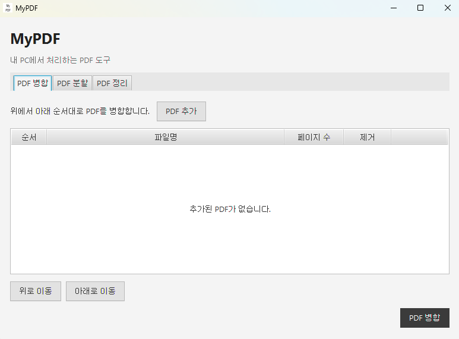
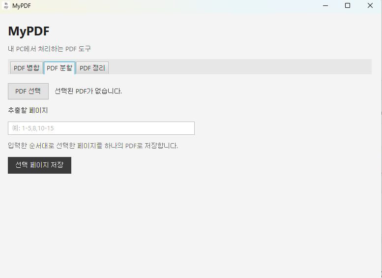
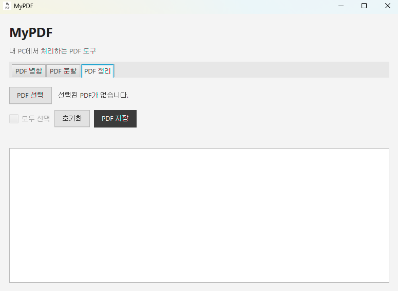
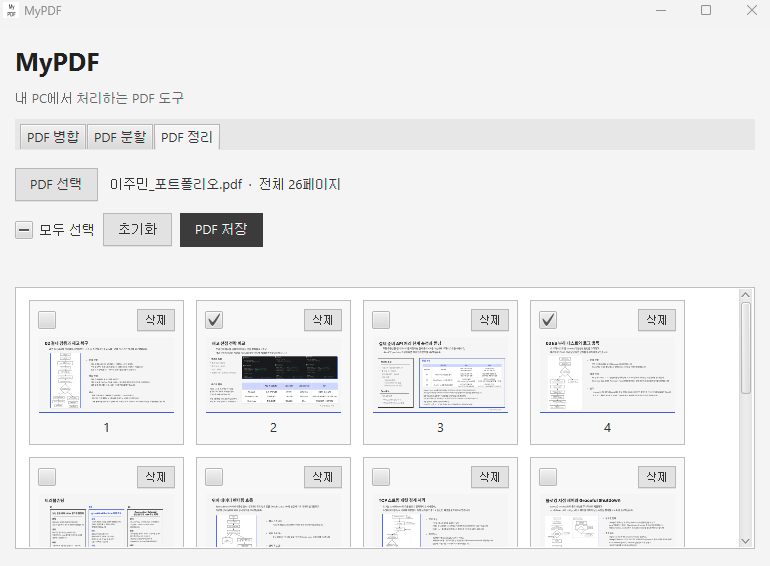

# 🐣 MyPDF 🐣

개인적으로 사용하기 위해 만든 간단한 데스크톱 PDF 유틸리티입니다.

PDF 파일을 외부 서버에 업로드하지 않고 로컬 PC에서 처리합니다.

## 📢 기능

### PDF 병합



여러 PDF 파일을 원하는 순서로 정렬하여 하나의 PDF로 병합합니다.

### PDF 분할



`1-5, 8, 10-15`와 같이 페이지를 지정하여 원하는 페이지만 새로운 PDF로 저장합니다.

### PDF 정리

<p>
  
  
</p>

PDF 페이지를 썸네일로 확인하면서 정리할 수 있습니다.

- 드래그 앤 드롭으로 페이지 순서 변경
- 필요한 페이지만 선택하여 저장
- 불필요한 페이지 삭제
- 원본 상태로 초기화

## 📢 실행 방법

### 설치

GitHub Releases에서 최신 버전의 `MyPDF-1.0.0.exe`를 다운로드합니다.

다운로드한 설치 파일을 실행하여 MyPDF를 설치합니다.

설치가 완료되면 Windows 시작 메뉴에서 `MyPDF`를 검색하여 실행할 수 있습니다.

별도의 Java, JavaFX, Gradle 설치는 필요하지 않습니다.

PDF 병합, 분할 및 정리 작업은 외부 서버를 사용하지 않고 로컬 PC에서 처리됩니다.

### 직접 실행

소스 코드를 직접 실행하려면 Java 25가 필요합니다.

저장소를 Clone한 뒤 프로젝트 폴더에서 다음 명령어를 실행합니다.

```bash
git clone https://github.com/Jmin0613/MyPDF.git
cd MyPDF
```

```powershell
.\gradlew.bat run
```

